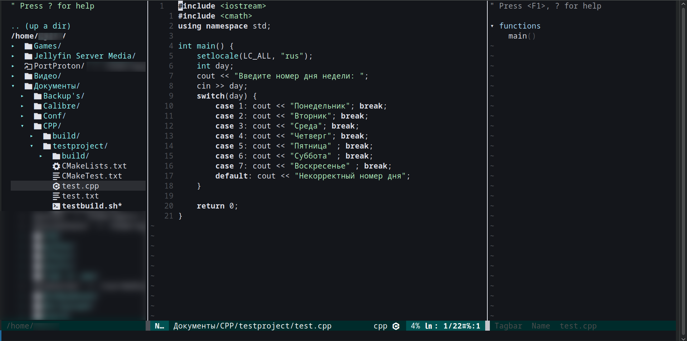

# Evim
<p align="center">
  
</p>


Данная конфигурация написана для личного использования и представляет собой набор плагинов и настроек для использования NeoVim в качестве IDE.

Создано на базе **vim-plug** с поддержкой:

- **LSP** — через `mason.nvim` + `mason-lspconfig.nvim` + `nvim-lspconfig`
- **Автодополнение** — `nvim-cmp` + `cmp-nvim-lsp` + `cmp-buffer` + `cmp-path` + `cmp-cmdline` + `cmp-vsnip`
- **Сниппеты** — `vim-vsnip`
- **Treesitter** — подсветка и парсеры (автовыбор ветки `main`/`master` в зависимости от версии Neovim)
- **Автопары** — `nvim-autopairs` с интеграцией в cmp
- **Файловый менеджер** — NERDTree
- **Терминал** — ToggleTerm
- **Поиск** — fzf + fzf.vim
- **Статусная строка** — vim-airline
- **Хоткеи-меню** — which-key (`<leader>wk`)
- **Git-маркеры** — gitsigns

---

## 📋 Требования

- **Neovim** ≥ 0.10 (рекомендуется 0.11 или 0.12)
- **git**, **curl**, **gcc**, **make**, **unzip**
- **nodejs** + **npm**
- **python3** + **pip**
- **ripgrep**, **fd**, **fzf**
- **universal-ctags**
- **wl-clipboard** (Wayland) или **xclip** (X11) — для `clipboard=unnamedplus`

### Установка зависимостей

**(рекомендуется) Alt Linux / p11:**
```sh
sudo apt-get install git curl gcc make unzip nodejs npm python3-module-pip ripgrep fd fzf universal-ctags wl-clipboard xclip
```

**Arch Linux:**
```sh
sudo pacman -S git curl gcc make unzip nodejs npm python-pip \
    ripgrep fd fzf ctags wl-clipboard xclip
```

**Debian / Ubuntu:**
```sh
sudo apt install git curl gcc make unzip nodejs npm python3-pip \
    ripgrep fd-find fzf universal-ctags wl-clipboard xclip
```

> ⚠️ В Debian/Ubuntu пакет `fd` называется `fd-find`, а бинарник — `fdfind`.  
> Симлинк: `mkdir -p ~/.local/bin && ln -sf "$(which fdfind)" ~/.local/bin/fd`

### 🔤 Nerd Fonts (опционально)

Для корректного отображения иконок в vim-devicons, vim-airline и NERDTree:

```sh
# 1. Папка для пользовательских шрифтов
mkdir -p ~/.local/share/fonts/JetBrainsMono

# 2. Скачиваем и распаковываем шрифт
curl -L https://github.com/ryanoasis/nerd-fonts/releases/latest/download/JetBrainsMono.tar.xz \
  | tar -xJ -C ~/.local/share/fonts/JetBrainsMono

# 3. Обновляем кэш шрифтов
fc-cache -fv
```

Проверка: `fc-list | grep -i "JetBrainsMono Nerd"`  
Не забудь указать шрифт `JetBrainsMono Nerd Font` в конфиге терминала (Alacritty/Kitty/Foot/WezTerm).

---

## 💾 Шаг 1. Резервная копия существующей конфигурации

Если конфиг Neovim уже существует, необходимо сделать бэкап, иначе он будет перезаписан.

**Вариант А — сохранить старое (рекомендуется):**
```sh
mv ~/.config/nvim{,.bak}
mv ~/.local/share/nvim{,.bak}
mv ~/.local/state/nvim{,.bak}
mv ~/.cache/nvim{,.bak}
```

**Вариант Б — полностью удалить:**
```sh
rm -rf ~/.config/nvim ~/.local/share/nvim ~/.local/state/nvim ~/.cache/nvim
```

---

## 📥 Шаг 2. Клонирование конфигурации

```sh
git clone https://github.com/3r0p100YKiN/evim.git ~/.config/nvim
```

---

## 🔌 Шаг 3. Установка vim-plug

```sh
sh -c 'curl -fLo "${XDG_DATA_HOME:-$HOME/.local/share}"/nvim/site/autoload/plug.vim --create-dirs \
       https://raw.githubusercontent.com/junegunn/vim-plug/master/plug.vim'
```

---

## 🚀 Шаг 4. Установка плагинов

```sh
nvim
```

Внутри:

```vim
:PlugInstall
```

Дождись завершения. Если появились ошибки — перезапусти `:PlugInstall` ещё раз.

---

## 🧩 Шаг 5. Установка LSP-серверов и инструментов

Mason, mason-lspconfig и mason-tool-installer настроены на автозапуск. При **первом** старте Neovim подтянутся:

**LSP-серверы:**
- `lua_ls`
- `pyright`
- `clangd`
- `bashls`

**Инструменты:**
- `stylua` — форматтер Lua
- `black` — форматтер Python
- `ruff` — линтер Python
- `shellcheck` — линтер Bash
- `clang-format` — форматтер C/C++

Прогресс:

```vim
:Mason
```

> ⚠️ Если через минуту LSP не подхватился — запусти `:MasonToolsInstall` вручную.

---

## 🌳 Шаг 6. Установка Treesitter-парсеров

Парсеры (`lua`, `python`, `c`, `cpp`, `bash`, `vim`, `vimdoc`) устанавливаются автоматически при первом запуске.

Ручная установка / обновление:

- **Neovim ≤ 0.11:**
  ```vim
  :TSUpdate
  ```
- **Neovim 0.12+:**
  ```lua
  :lua require('nvim-treesitter').install { 'lua', 'python', 'c', 'cpp', 'bash', 'vim', 'vimdoc' }
  ```

---

## ✅ Шаг 7. Проверка

```vim
:checkhealth
```

Открой любой `.lua` / `.py` / `.c` файл и проверь:
- через 2–3 сек. инициализируется LSP (`:LspInfo` покажет активные серверы);
- работает автодополнение (`<C-Space>` или автоматически);
- есть диагностика (подчёркивания, `]d` / `[d`);
- открывается терминал (`<leader>tt`);
- работает поиск файлов (`<leader>ff`).

---

## ⌨️ Горячие клавиши

**Leader** — пробел.

### Диагностика (LSP)
| Клавиша | Действие |
|---|---|
| `]d` | Следующая диагностика |
| `[d` | Предыдущая диагностика |
| `<leader>e` | Плавающее окно диагностики |
| `<leader>q` | Диагностика в loclist |

### Поиск (fzf)
| Клавиша | Действие |
|---|---|
| `<leader>ff` | Поиск файлов |
| `<leader>fl` | Поиск по строкам буфера |
| `<leader>fw` | Поиск по открытым окнам |

### NERDTree
| Клавиша | Действие |
|---|---|
| `<leader>nt` | Открыть NERDTree |
| `<leader>nf` | NERDTree Find |
| `<leader>ne` | NERDTree Explore |

### Терминал (ToggleTerm)
| Клавиша | Действие |
|---|---|
| `<leader>tt` | Открыть/закрыть терминал |
| `<leader>tb` | Терминал в новой вкладке |
| `<leader>tf` | Плавающий терминал |
| `<Esc>` / `jk` | Выход из терминального режима |
| `<C-h/j/k/l>` | Навигация между окнами из терминала |

### Прочее
| Клавиша | Действие |
|---|---|
| `<leader>wk` | Меню WhichKey |
| `<C-Space>` | Вызвать автодополнение |
| `<C-e>` | Отменить автодополнение |
| `<CR>` | Подтвердить выбранный пункт cmp |
| `<C-b>` / `<C-f>` | Скролл документации |

---

## 📁 Структура

```
~/.config/nvim/
├── init.vim                        # Точка входа, базовые опции
├── plugins.vim                     # Список плагинов (vim-plug)
└── lua/
    ├── autopairs-config.lua
    ├── cmp-config.lua
    ├── keymap-config.lua
    ├── mason-lspconfig-config.lua
    ├── mason-tool-installer-config.lua
    ├── toggleterm-config.lua
    └── treesitter-config.lua
```

---

## 🔄 Обновление

```vim
:PlugUpdate        " обновить плагины
:PlugUpgrade       " обновить сам vim-plug
:TSUpdate          " обновить Treesitter-парсеры (≤ 0.11)
:Mason             " управление LSP/инструментами
```

Для Neovim 0.12+ парсеры обновляются так:

```lua
:lua require('nvim-treesitter').update()
```

После обновления Treesitter иногда требуется перезапуск Neovim.

---

## 🗑️ Откат к прежней конфигурации

```sh
rm -rf ~/.config/nvim
mv ~/.config/nvim.bak ~/.config/nvim

mv ~/.local/share/nvim.bak ~/.local/share/nvim 2>/dev/null
mv ~/.local/state/nvim.bak ~/.local/state/nvim 2>/dev/null
mv ~/.cache/nvim.bak ~/.cache/nvim 2>/dev/null
```

---

## 📝 Заметки

- Менеджер плагинов — **vim-plug**, а не lazy.nvim. Если нужен именно lazy.nvim — используйте LazyVim.
- Конфиг рассчитан на **Neovim 0.11+**. Для 0.12+ автоматически выбирается ветка `main` у `nvim-treesitter`, для более старых — `master`.
- Ветка Treesitter выбирается в `plugins.vim` через `has('nvim-0.12')`, а логика инициализации — в `treesitter-config.lua`.
- Глобальные **capabilities** для LSP задаются один раз в `cmp-config.lua` через `vim.lsp.config("*", { capabilities = ... })`.
- Для `clangd` указан `--query-driver=/usr/bin/g++`. Если путь отличается — укажи его в `mason-lspconfig-config.lua` (узнать: `which g++`).
- `map_c_h` и `map_c_w` в autopairs отключены, чтобы не конфликтовать со стандартным `<C-h>`/`<C-w>`.
- Терминальные хоткеи вешаются через `autocmd TermOpen term://*` — работают во **всех** терминалах, не только в ToggleTerm.
